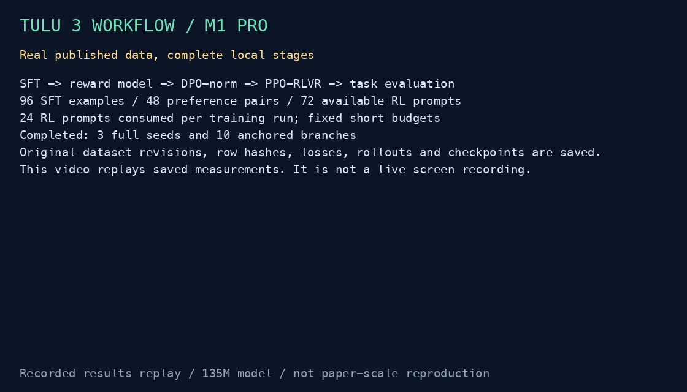
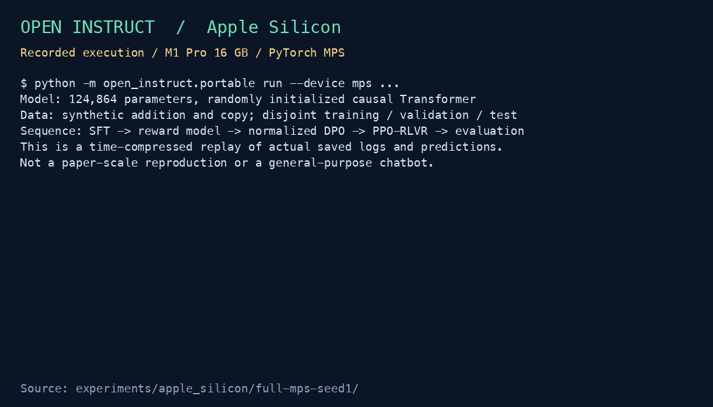
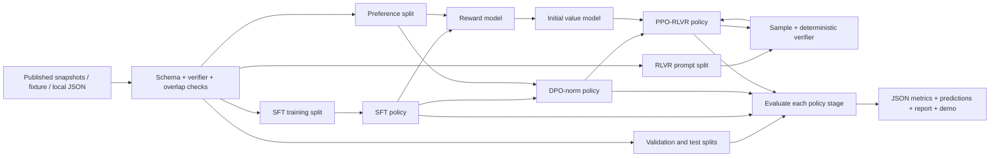
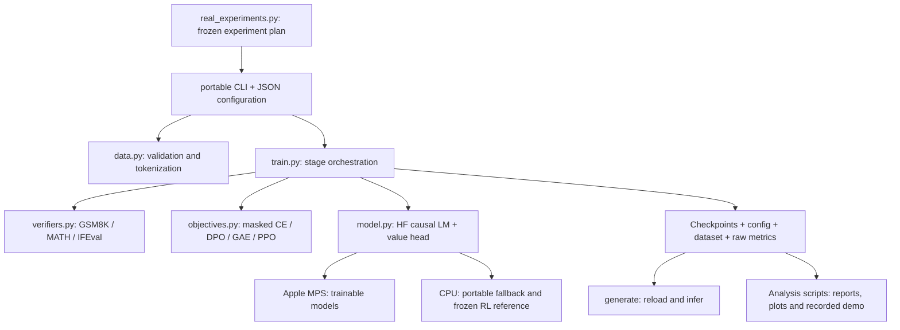

[](https://github.com/allenai/open-instruct/actions/workflows/tests.yml)
[](https://paperswithcode.co/api/v1/papers/2512.13961/leaderboard-badge-link?eval=8028)
[](https://paperswithcode.co/api/v1/papers/2512.13961/leaderboard-badge-link?eval=8025)

# Tulu-M1

**English** | [简体中文](README.zh-CN.md)

An Apple Silicon adaptation of [Open Instruct](https://github.com/allenai/open-instruct) for reproducible, reduced-scale Tülu 3 experiments, covering SFT, reward modeling, DPO, PPO-RLVR, and evaluation with efficient memory use, transparent results, and bilingual documentation.

This repository preserves the upstream training workflows and history. The badges above report upstream results. Upstream code retains its [Apache 2.0 license](LICENSE); the destination repository's initial MIT license is preserved in [LICENSE.InfronAI](LICENSE.InfronAI). Model and dataset licenses remain separate.

Open Instruct serves as an open effort on instruction-tuning and post-training popular pretrained language models on publicly available datasets. The upstream project provides:

1. Code for finetuning language models with latest techniques and instruction datasets in a unified format.
2. Code for DPO, preference finetuning and reinforcement learning with verifiable rewards (RLVR).
3. Checkpoints or other useful artifacts that we build in our exploration.

**Olmo 3 results:** The live Papers with Code badges above track **Olmo 3 Think 32B** on BBH and **Olmo 3.1 Think 32B** on MATH. See [Table 14 of the Olmo 3 paper](https://arxiv.org/html/2512.13961v2#S4.T14) for the reported scores.

We also support some evaluations natively in the codebase, but these are now unmaintained and instead we suggest using [OLMES](https://github.com/allenai/olmes), which we used for TÜLU 3.

<p align="center" width="100%">
      
</p>

## Apple Silicon: a complete local post-training workflow

Run **data preparation → SFT → reward model → DPO-norm → PPO-RLVR → evaluation → saved-model inference** on an M1 Mac, using PyTorch MPS or CPU. The new `open_instruct.portable` backend is independent of CUDA, vLLM, DeepSpeed, Ray, Beaker, API keys and paid services. Existing distributed trainers and model workflows remain available below.

This is a **small-scale implementation of the Tülu 3 stage sequence**, not a reproduction of its published benchmark scores. The offline demo trains a 124K-parameter causal Transformer from random initialization on synthetic addition/copy tasks. A separate pinned SmolLM2-135M preset exercises pretrained-model finetuning. Neither replaces the paper's Llama models, datasets or OLMES evaluation. See the [paper coverage and remaining gaps](docs/apple_silicon.md#paper-coverage) and [measured experiment report](experiments/apple_silicon/REPORT.md).

### Quick start (Mac)

Use native arm64 Python 3.11 or 3.12 and macOS 14+. An M1 Pro with 16 GB unified memory was used for validation; an 8 GB base M1 has not been measured. The tiny workflow is the starting point for limited memory.

```bash
git clone https://github.com/InfronAI/Tulu-M1.git
cd Tulu-M1

# If needed: brew install python@3.11
PYTHON_BIN=python3.11 bash scripts/portable/setup.sh
.venv-mac/bin/python -m open_instruct.portable doctor

# Optional: inspect the generated data. The default run uses the same fixture.
.venv-mac/bin/python -m open_instruct.portable prepare --output output/mac-data.json
.venv-mac/bin/python -m open_instruct.portable run \
  --config configs/portable/tiny.json --device mps --output output/mac-demo

# Load the actual saved model; no model download is needed.
.venv-mac/bin/python -m open_instruct.portable generate \
  --checkpoint output/mac-demo/checkpoints/rlvr \
  --prompt "Copy 42. Answer with only the number." --max-new-tokens 5
make mac-check
```

Choose `--device cpu` for CPU execution. `auto` selects MPS when available. Output directories must be new to prevent overwriting previous experiments. Initial installation needs internet access; the tiny training and inference workflow then runs offline. Use the isolated environment above; root `uv sync` installs the distributed training stack and is **not the Mac setup command**.

For pretrained models, custom data, reproducible experiments, memory limits and troubleshooting, see the [Mac guide](docs/apple_silicon.md).

### Tülu 3 real-data experiments

The follow-up study uses **published Tülu 3 SFT/preference/RLVR data**, not the synthetic fixture. It adds GSM8K numeric grading, symbolic MATH grading, original RLVR instruction constraints, strict/loose IFEval metrics, epoch sampling, linear schedules, KV-cached generation, batched evaluation and checkpoint-anchored ablations. The data scan covers every pinned SFT/preference shard, with explicit source/length sampling and overlap checks.

On the **16 GB M1 Pro**, the recorded study completed **3 full training seeds, 10 anchored RL branches, and all 2,360 benchmark questions**, plus a 16-pair preference holdout scored at four stages for every seed. See the [experiment report](experiments/tulu3_real/REPORT.md), [subgroup analysis](experiments/tulu3_real/BENCHMARK_ANALYSIS.md), and [protocol](docs/tulu3_mac_experiments.md).

| Final seed-1 benchmark | Recorded verifier result |
|---|---:|
| GSM8K, 1,319 questions | 23 / 1,319 — **1.74%** |
| MATH-500, 500 questions | 7 / 500 — **1.40%** micro; **0.98%** subject macro |
| IFEval, 541 prompts | **14.60%** strict; **17.01%** loose |

These are zero-shot, 128-token results from SmolLM2-135M. The 72-question stage panel declined from 6.94% to 1.39% across three seeds, and 5 of the 7 full-bank MATH passes contain a copied question expression. The report retains negative results, EOS failures and scoring limitations. These measurements do not reproduce paper-scale gains or the full OLMES suite.

A paired 512-token check on the seed-1 base and final checkpoints is also complete: GSM8K/MATH panel scores did not improve, and all 144 responses reached the cap. The [audit](experiments/tulu3_real/audit.json) has no pending experiments; the portable suite passed **30 tests**.

```bash
# Create a fresh workspace: recorded metrics are versioned, model weights are not.
PYTHON_BIN=python3.11 MAC_ENV=.venv-mac-real bash scripts/portable/setup.sh
.venv-mac-real/bin/python -m scripts.portable.reproduce_real \
  --workspace output/tulu3-reproduction
```

The reproduction entrypoint copies pinned inputs into a new directory, then runs training, benchmarks, holdout and decoding-budget checks, analysis, audit and demo generation. It refuses to overwrite an existing workspace. The measured checkpoints remain local and git-ignored.

[](assets/demo/tulu3-real.mp4)

[30-second MP4](assets/demo/tulu3-real.mp4) · [Autoplay video page](assets/demo/tulu3-real.html). This is a replay of saved metrics and predictions, including incorrect responses, not a live screen recording. The GIF loops in the README; GitHub does not guarantee embedded MP4 autoplay. Serve the repository with `python3 -m http.server 8000 --bind 127.0.0.1` and open <http://127.0.0.1:8000/assets/demo/tulu3-real.html> for muted video autoplay, subject to browser settings.

### Measured local results (initial synthetic study)

On the 16 GB M1 Pro, the three tiny-model MPS runs completed in 46–51 seconds each (training, evaluation and checkpoint writes). Their final held-out exact match was **55.21% ± 1.80 percentage points** (sample standard deviation, 32 synthetic test prompts). The CPU control took 18.6 seconds. The 135M pretrained-model run completed all stages in 105.7 seconds, excluding initialization/download; its SFT, DPO and RLVR checkpoints each scored 56.25%, so this short run shows no additional correctness gain after SFT. These measurements are workload-specific. [Raw results and limitations](experiments/apple_silicon/REPORT.md).

### Demo

[](assets/demo/portable-demo.mp4)

[Download MP4](assets/demo/portable-demo.mp4) · [Autoplay video page](assets/demo/index.html) · [Recording source](experiments/apple_silicon/full-mps-seed1-terminal.jsonl)

The GIF loops inline in the README. The MP4 is a time-compressed replay of recorded training output and saved predictions, generated by `scripts/portable/report.py`. GitHub sanitizes README HTML and does not guarantee video autoplay. For actual muted MP4 autoplay, run `python3 -m http.server 8000 --bind 127.0.0.1` and open <http://127.0.0.1:8000/assets/demo/>. Browser settings can still block autoplay; playback controls remain available.

### Data flow



### Execution architecture



The portable path uses FP32, explicit response/EOS masks, gradient accumulation, cached DPO reference probabilities, dropout-free PPO and an RM-initialized value model. It rejects oversized sequences rather than silently truncating answers. The CPU reference reduces accelerator allocation pressure but still consumes unified memory. It does not implement CUDA/MoE kernels or distributed serving; supported Olmo MoE training continues to use [MILES](docs/miles/grpo.md).

## Setup (distributed NVIDIA training)

Our setup follows our [Dockerfile](./Dockerfile). *Note that Open Instruct is a research codebase and does not guarantee backward compatibility.*

### Installation with uv

We use [uv](https://docs.astral.sh/uv/) for installation and running code. You can install with `uv sync`.

* **Git LFS** (for running tests): Install [Git LFS](https://git-lfs.com/) and run `git lfs install` before cloning. See [CONTRIBUTING.md](CONTRIBUTING.md#git-lfs) for details.

* **Docker installation**: You can also use the Dockerfile to build a Docker image. You can build the image with the following command:

```bash
docker build . \
    --build-arg GIT_COMMIT=$(git rev-parse --short HEAD) \
	--build-arg GIT_BRANCH=$(git rev-parse --abbrev-ref HEAD) \
	-t open_instruct_dev
```


## Training

After having setup the environment, you are ready to launch some experiments. We provide a few examples below. To learn more about how to reproduce the Tulu 3 models, please refer to the [Tulu 3 README](./docs/tulu3.md). The instructions and documentations for Tulu 1 and Tulu 2 are in [Tulu 1 and 2 README](./docs/tulu1_tulu2.md).

The launch commands below run on Ai2's Beaker clusters. `scripts/train/build_image_and_launch.sh` builds an image from your current commit and passes it to the chosen script. Most of these scripts pass mason's `--preemptible`, so on clusters that enforce priority they run only as backfill and can wait indefinitely. Scripts that launch evals (`--try_launch_beaker_eval_jobs_on_weka`) also need `oe-eval-internal` cloned at the repository root.

### Finetuning

**OLMo-core SFT**: For supported models (OLMo, OLMoE, Qwen3), we recommend the more GPU-efficient [OLMo-core SFT implementation](https://github.com/allenai/OLMo-core/tree/main/src/scripts/train/sft). See `open_instruct/olmo_core_utils.py` for the list of supported models. Our entry point is `open_instruct/olmo_core_finetune.py`:

```bash
# Single-GPU OLMo-core SFT smoke test on Beaker (Qwen3-0.6B).
./scripts/train/build_image_and_launch.sh scripts/train/debug/oc_sft.sh

# Two-node 8xGPU OLMo-core SFT run.
./scripts/train/build_image_and_launch.sh scripts/train/debug/oc_sft_multinode.sh
```


### Preference Tuning

We train DPO with `open_instruct/dpo.py`:

```bash
# Single-GPU DPO smoke test on Beaker (OLMo-2 1B).
./scripts/train/build_image_and_launch.sh scripts/train/debug/dpo/single_gpu.sh

# Two-node 8xGPU DPO run.
./scripts/train/build_image_and_launch.sh scripts/train/debug/dpo/multi_node.sh
```


### Reinforcement Learning with Verifiable Rewards (RLVR)

For supported Olmo MoE models, use the [MILES + OLMo-core integration](docs/miles/grpo.md).
The existing [Core/vLLM and DeepSpeed/vLLM GRPO workflows](docs/algorithms/grpo.md)
remain available for dense-model training; the commands below use DeepSpeed/vLLM.

We train with `open_instruct/grpo_fast.py`:

```bash
# Single-GPU smoke test on Beaker (small model, fast).
./scripts/train/build_image_and_launch.sh scripts/train/debug/single_gpu_on_beaker.sh

# Two-node 8xGPU run (Qwen2.5-7B on code RLVR).
./scripts/train/build_image_and_launch.sh scripts/train/debug/large_test_script.sh
```


## Contamination checks

We release our scripts for measuring the overlap between instruction tuning datasets and evaluation datasets in `./decontamination`. See the [README](./decontamination/README.md) for more details.

### Developing
When submitting a PR to this repo, we check the core code in `open_instruct/` for style with the following:
```
make style
make quality
```

Run the tests with `uv run pytest`.

#### Pre-commit hooks

To automatically run linting and formatting on each commit:
```bash
uv run pre-commit install
```

To run on all files (recommended after initial setup):
```bash
uv run pre-commit run --all-files
```

### Repo structure
```
├── assets/                     <- Images, licenses, etc.
├── configs/
|     ├── beaker_configs/       <- AI2 Beaker configs
|     ├── ds_configs/           <- DeepSpeed configs
|     └── train_configs/        <- Training configs
├── decontamination/            <- Scripts for measuring train-eval overlap
├── docs/                       <- Documentation (MkDocs)
├── human_eval/                 <- Human evaluation interface (not maintained)
├── open_instruct/              <- Source code (training scripts and utilities)
├── scripts/
|     ├── train/                <- Training launch scripts; debug/ has smoke tests
|     ├── eval/                 <- Evaluation scripts
|     └── data/                 <- Dataset preparation scripts
├── tests/                      <- Additional tests (most live next to the code)
├── mason.py                    <- Beaker job launcher
└── Dockerfile                  <- Dockerfile
```


## Licensing

This codebase is licensed under Apache 2.0 as given in [LICENSE](./LICENSE).

The license we use for V1 models released (along with the base model licenses) can be found in [assets/model_licenses/tulu_license.txt](./assets/model_licenses/tulu_license.txt) - just replace `<MODELNAME>` with the actual model name (i.e., the name on HuggingFace).

V2 models are licensed under the [low-risk AI2 ImpACT license](https://allenai.org/licenses/impact-lr). See [here](https://allenai.org/impact-license) for more details.


## Acknowledgements

Open Instruct is a project that benefited from many open-source projects and libraries. We would like to particularly thank the following projects:

* [HuggingFace Transformers](https://github.com/huggingface/transformers): We adapted Hugging Face's Trainer for our finetuning scripts.
* [HuggingFace TRL](https://github.com/huggingface/trl) and [eric-mitchell/direct-preference-optimization](https://github.com/eric-mitchell/direct-preference-optimization): our preference tuning code is adapted from TRL and from Eric Mitchell's DPO code.
* OpenAI's [lm-human-preferences](https://github.com/openai/lm-human-preferences), [summarize-from-feedback](https://github.com/openai/summarize-from-feedback), and [vwxyzjn/summarize_from_feedback_details](https://github.com/vwxyzjn/summarize_from_feedback_details): Our core PPO code is adapted from OpenAI's original RLHF code and [Huang et al (2024)'s reproduction work](https://openreview.net/forum?id=kHO2ZTa8e3) of OpenAI's summarize from feedback work.
* [OpenRLHF](https://github.com/OpenRLHF/OpenRLHF): We adapted OpenRLHF's Ray + vLLM distributed code for scaling up PPO RLVR training into the 70B scale.

## Citation

If you used this repository or our models, please cite our work:

Tulu 1:
```bibtex
@misc{wang2023far,
   title={How Far Can Camels Go? Exploring the State of Instruction Tuning on Open Resources},
   author={Yizhong Wang and Hamish Ivison and Pradeep Dasigi and Jack Hessel and Tushar Khot and Khyathi Raghavi Chandu and David Wadden and Kelsey MacMillan and Noah A. Smith and Iz Beltagy and Hannaneh Hajishirzi},
   year={2023},
   eprint={2306.04751},
   archivePrefix={arXiv},
   primaryClass={cs.CL}
}
```

Tulu 2:
```bibtex
@misc{ivison2023camels,
      title={Camels in a Changing Climate: Enhancing LM Adaptation with Tulu 2},
      author={Hamish Ivison and Yizhong Wang and Valentina Pyatkin and Nathan Lambert and Matthew Peters and Pradeep Dasigi and Joel Jang and David Wadden and Noah A. Smith and Iz Beltagy and Hannaneh Hajishirzi},
      year={2023},
      eprint={2311.10702},
      archivePrefix={arXiv},
      primaryClass={cs.CL}
}
```

Tulu 2.5:
```bibtex
@misc{ivison2024unpacking,
      title={Unpacking DPO and PPO: Disentangling Best Practices for Learning from Preference Feedback},
      author={Hamish Ivison and Yizhong Wang and Jiacheng Liu and Zeqiu Wu and Valentina Pyatkin and Nathan Lambert and Noah A. Smith and Yejin Choi and Hannaneh Hajishirzi},
      year={2024},
      eprint={2406.09279},
      archivePrefix={arXiv},
      primaryClass={cs.CL},
}
```

Tulu 3:
```bibtex
@article{lambert2024tulu3,
  title = {Tülu 3: Pushing Frontiers in Open Language Model Post-Training},
  author = {
    Nathan Lambert and Jacob Morrison and Valentina Pyatkin and Shengyi Huang and Hamish Ivison and Faeze Brahman and Lester James V. Miranda and Alisa Liu and Nouha Dziri and Shane Lyu and Yuling Gu and Saumya Malik and Victoria Graf and Jena D. Hwang and Jiangjiang Yang and Ronan Le Bras and Oyvind Tafjord and Chris Wilhelm and Luca Soldaini and Noah A. Smith and Yizhong Wang and Pradeep Dasigi and Hannaneh Hajishirzi
  },
  year = {2024},
  email = {tulu@allenai.org}
}
```

OLMo 3:
```bibtex
@misc{olmo2025olmo3,
      title={OLMo 3},
      author={Team OLMo and Allyson Ettinger and Amanda Bertsch and Bailey Kuehl and David Graham and David Heineman and Dirk Groeneveld and Faeze Brahman and Finbarr Timbers and Hamish Ivison and Jacob Morrison and Jake Poznanski and Kyle Lo and Luca Soldaini and Matt Jordan and Mayee Chen and Michael Noukhovitch and Nathan Lambert and Pete Walsh and Pradeep Dasigi and Robert Berry and Saumya Malik and Saurabh Shah and Scott Geng and Shane Arora and Shashank Gupta and Taira Anderson and Teng Xiao and Tyler Murray and Tyler Romero and Victoria Graf and Akari Asai and Akshita Bhagia and Alexander Wettig and Alisa Liu and Aman Rangapur and Chloe Anastasiades and Costa Huang and Dustin Schwenk and Harsh Trivedi and Ian Magnusson and Jaron Lochner and Jiacheng Liu and Lester James V. Miranda and Maarten Sap and Malia Morgan and Michael Schmitz and Michal Guerquin and Michael Wilson and Regan Huff and Ronan Le Bras and Rui Xin and Rulin Shao and Sam Skjonsberg and Shannon Zejiang Shen and Shuyue Stella Li and Tucker Wilde and Valentina Pyatkin and Will Merrill and Yapei Chang and Yuling Gu and Zhiyuan Zeng and Ashish Sabharwal and Luke Zettlemoyer and Pang Wei Koh and Ali Farhadi and Noah A. Smith and Hannaneh Hajishirzi},
      year={2025},
      eprint={2512.13961},
      archivePrefix={arXiv},
      primaryClass={cs.CL},
      url={https://arxiv.org/abs/2512.13961},
}
```
