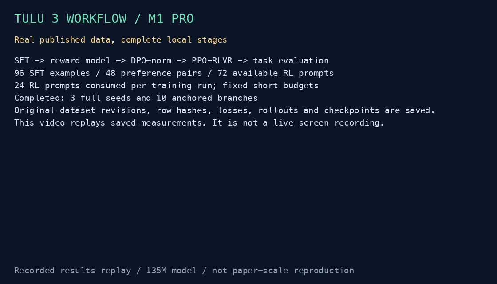
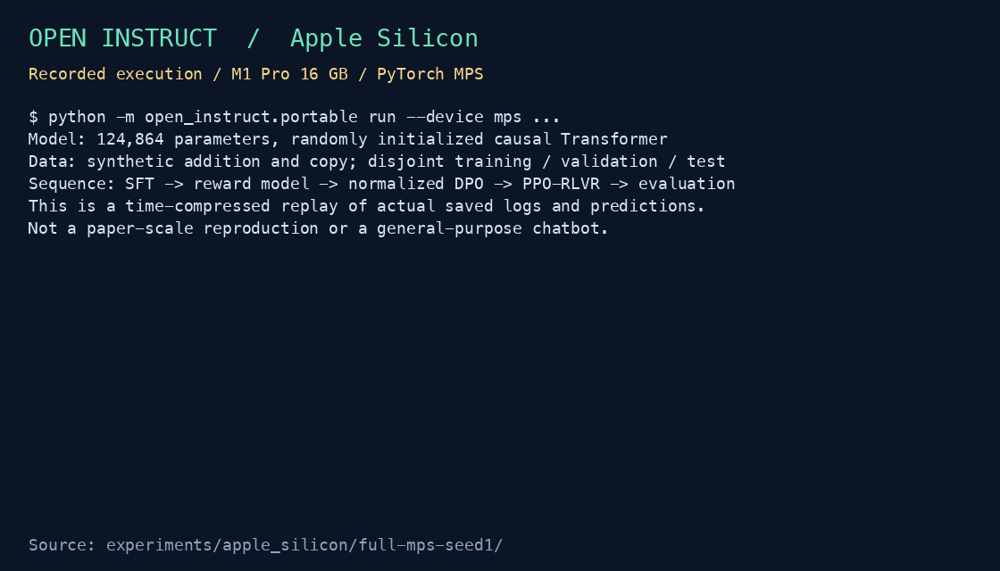
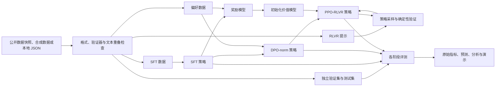

# Tulu-M1

[English（默认）](README.md) | **简体中文**

基于 [Open Instruct](https://github.com/allenai/open-instruct) 的 Apple Silicon 适配项目，在 M1 Mac 上进行可复现的小规模 Tülu 3 实验，覆盖 SFT、奖励模型、DPO、PPO-RLVR 与评测，提供内存优化、完整实验记录及双语文档。

Open Instruct 面向开放语言模型的指令微调与后训练，提供统一数据格式下的 SFT、偏好优化、强化学习以及相关模型和实验配置。本仓库覆盖 Tülu 1/2/3、OLMo 和后续 Olmo 系列。当前 Mac 改造以 **Tülu 3** 论文为依据，保留已有 NVIDIA 多卡、Beaker 和 MILES 工作流。

原项目的最新 Olmo 3 结果见 [Olmo 3 论文](https://arxiv.org/html/2512.13961v2#S4.T14)。正式能力评测建议使用项目原有的 [OLMES](https://github.com/allenai/olmes) 体系；本机演示的小型评测不替代该体系。

## 在 M1 Mac 上端到端运行

新增 `open_instruct.portable` 后端，执行：**数据准备 → SFT → 奖励模型 → 长度归一化 DPO → PPO-RLVR → 评测 → 保存模型推理**。它使用 PyTorch MPS 或 CPU，无需 CUDA、vLLM、DeepSpeed、Ray、Beaker 或付费 API。

实际验证设备为 **Apple M1 Pro / 16 GB / macOS 26.6.1**。依赖要求原生 arm64 Python 3.11 或 3.12、macOS 14 及以上。未测量 8 GB 的基础款 M1。首次安装需要联网，微型模型流程安装后可以离线运行。

**范围说明：**默认运行的是随机初始化的约 12.5 万参数因果 Transformer，任务为合成加法与数字复制；另有固定版本的 SmolLM2-135M 预训练模型配置。两者验证真实训练流程，但不等价于论文的 Llama 模型、原始数据混合与完整基准复现。详见[论文覆盖与缺口](docs/apple_silicon.md#paper-coverage)和[实测报告](experiments/apple_silicon/REPORT.md)。本项目没有宣称已经完成论文的全部实验或达到论文分数。

```bash
git clone https://github.com/InfronAI/Tulu-M1.git
cd Tulu-M1

# 如有需要：brew install python@3.11
PYTHON_BIN=python3.11 bash scripts/portable/setup.sh
.venv-mac/bin/python -m open_instruct.portable doctor

# 可选：将默认数据导出供检查
.venv-mac/bin/python -m open_instruct.portable prepare --output output/mac-data.json

# 输出目录必须是新目录，避免覆盖已有实验
.venv-mac/bin/python -m open_instruct.portable run \
  --config configs/portable/tiny.json --device mps --output output/mac-demo

# 使用真实保存的模型推理
.venv-mac/bin/python -m open_instruct.portable generate \
  --checkpoint output/mac-demo/checkpoints/rlvr \
  --prompt "Copy 42. Answer with only the number." --max-new-tokens 5

make mac-check
```

指定 `--device cpu` 可使用 CPU；`auto` 优先选择 MPS。Mac 使用独立的 `.venv-mac` 环境，**不要用根目录的 `uv sync` 安装 Mac 后端**，后者服务于集群依赖栈。

预训练模型、批量实验和报告生成：

```bash
.venv-mac/bin/python -m open_instruct.portable run \
  --config configs/portable/smollm2.json --device mps --output output/smollm2

.venv-mac/bin/python scripts/portable/experiments.py \
  --include-pretrained --output output/my-experiments
.venv-mac/bin/python scripts/portable/report.py \
  --input output/my-experiments --demo-dir output/my-demo
```

135M 配置首次运行会下载固定版本的模型，以 FP32 全参数训练，并保存各阶段权重，需要额外数 GB 磁盘空间。视频生成需 `ffmpeg`（`brew install ffmpeg`）。完整参数、数据规范、内存策略与限制见 [Mac 使用指南](docs/apple_silicon.md)。

## Tülu 3 真实数据实验补全

后续实验改用论文发布的 **SFT、偏好与 RLVR 原始数据**，增加 GSM8K 数值评分、MATH 符号评分、原始 RLVR 约束、IFEval 严格/宽松指标、按 epoch 采样、线性学习率、KV cache、批量生成，以及从同一检查点分叉的消融。数据扫描覆盖固定版本的全部 SFT/偏好分片，记录来源抽样、长度过滤和污染检查。

已在 **16 GB M1 Pro** 上完成 **3 个全流程种子、10 个固定检查点 RL 分支和全部 2,360 道评测题**，并对每个种子的四个阶段评估了 16 对独立偏好样本。所有结果及失败记录见[实验报告](experiments/tulu3_real/REPORT.md)、[分组分析](experiments/tulu3_real/BENCHMARK_ANALYSIS.md)和[复现指南](docs/tulu3_mac_experiments.md)。

| 第一组最终检查点的评测 | 验证器实测结果 |
|---|---:|
| GSM8K，1,319 题 | 23 / 1,319，**1.74%** |
| MATH-500，500 题 | 7 / 500，普通正确率 **1.40%**；学科平均 **0.98%** |
| IFEval，541 条提示 | strict **14.60%**；loose **17.01%** |

以上使用 SmolLM2-135M、零样本提示和 128-token 上限。三个种子的 72 题阶段评测均值从 6.94% 降至 1.39%；完整 MATH-500 的 7 个通过样本中，5 个包含从题目复制的表达式。报告保留负结果、EOS 问题和评分局限，不能据此宣称复现论文增益、原始 8B–405B 规模或全部 OLMES 评测。

还完成了第一组基座与最终检查点的 512-token 配对对照：GSM8K/MATH 小题集分数没有提高，全部 144 条回答用满上限。[结果审计](experiments/tulu3_real/audit.json)无待完成项，Mac 专项测试 **30 项全部通过**。

```bash
PYTHON_BIN=python3.11 MAC_ENV=.venv-mac-real bash scripts/portable/setup.sh
.venv-mac-real/bin/python -m scripts.portable.reproduce_real \
  --workspace output/tulu3-reproduction
```

复跑入口在新目录复制固定输入，依次执行训练、完整题库评测、偏好与生成预算对照、分析、审计和演示生成；已有目录不会被覆盖。这样新克隆不会因为已有结果 JSON 而误跳过训练：检查点仅保存在本地，由 Git 忽略。数据快照已随项目保存，模型首次使用仍需下载。新实验使用独立 PyTorch 2.15 环境，初始合成实验及其 PyTorch 2.8 环境记录保留。

[](assets/demo/tulu3-real.mp4)

[30 秒 MP4](assets/demo/tulu3-real.mp4) · [视频自动播放页面](assets/demo/tulu3-real.html)。内容来自保存的指标与预测，包含错误回答，是记录回放而非实时录屏。README 中 GIF 自动循环；GitHub 无法保证内嵌 MP4 自动播放。运行 `python3 -m http.server 8000 --bind 127.0.0.1`，访问 <http://127.0.0.1:8000/assets/demo/tulu3-real.html> 可播放静音循环视频，仍受浏览器设置控制。

## 本机实测结果（初始合成实验）

三个微型模型 MPS 主实验每次耗时 46–51 秒（包括训练、评测和保存），最终留出集正确率为 **55.21% ± 1.80 个百分点**（跨种子样本标准差，32 条合成测试提示）。CPU 对照用时 18.6 秒。135M 预训练模型全阶段用时 105.7 秒，不含初始化和下载；其 SFT、DPO、RLVR 正确率均为 56.25%，因此本次短跑没有观察到 SFT 之后的正确率提升。完整数据、测量方法和局限见[实测报告](experiments/apple_silicon/REPORT.md)。

## 运行演示

[](assets/demo/portable-demo.mp4)

[下载 MP4](assets/demo/portable-demo.mp4) · [自动播放页面](assets/demo/index.html) · [原始记录](experiments/apple_silicon/full-mps-seed1-terminal.jsonl)

README 内的 GIF 自动循环。MP4 展示的是真实运行日志与保存预测的压缩时间回放，不是实时录屏；固定展示测试集前四条，包含错误答案。GitHub 会清理 README 的 HTML，无法保证内嵌 MP4 自动播放。需要真正的视频自动播放时，运行：

```bash
python3 -m http.server 8000 --bind 127.0.0.1
```

打开 <http://127.0.0.1:8000/assets/demo/>。页面使用静音自动播放、循环和内联播放属性，同时保留播放按钮以兼容浏览器限制。

## 数据流图



## 结构流程图

```mermaid
flowchart TD
    EXP[real_experiments.py 固定实验计划] --> CLI
    CLI[命令行与 JSON 配置] --> DATA[data.py 数据校验与分词]
    CLI --> TRAIN[train.py 训练阶段编排]
    TRAIN --> VERIFY[verifiers.py GSM8K / MATH / IFEval]
    TRAIN --> OBJ[objectives.py SFT / DPO / GAE / PPO]
    TRAIN --> MODEL[model.py 因果模型与价值模型]
    MODEL --> MPS[Apple MPS 训练]
    MODEL --> CPU[CPU 执行与冻结参考策略]
    TRAIN --> SAVE[检查点、数据、配置和逐步日志]
    SAVE --> INFER[generate 加载模型推理]
    SAVE --> REPORT[分析脚本：报告、图表与记录回放视频]
```



## 训练与内存策略

SFT 只计算回答和 EOS 的损失，屏蔽提示与 padding；梯度累积按整个有效批次的回答 token 数归一化。DPO 使用冻结 SFT 概率缓存，减少参考模型占用。奖励模型采用偏好对训练，并初始化独立的 PPO 价值模型。RLVR 保留 PPO、GAE、策略/价值裁剪、参考策略 KL 与缺失 EOS 惩罚，不用 GRPO 替代论文的 PPO。

MPS 默认 FP32、SDPA 注意力及训练激活检查点，进程分配上限为建议工作集的 55%，并在步骤及阶段间释放闲置缓存。RL 的冻结参考策略在 CPU 上执行，但 M1 使用统一内存，CPU 权重仍占物理 RAM。生成使用 KV cache，仅投影最后位置的词表分数；评测支持左侧 padding 和批量生成，训练 rollout 仍逐条采样。上下文超长会报错，不会静默截断答案。未实现中断后的优化器恢复；已有输出目录不会被覆盖。初始合成实验采用 eager attention，其历史代码与结果仍保留。

本地数据 JSON 必须包含 `sft`、`preference`、`rlvr`、`validation`、`test` 五个非空数组。合成数据包含 `prompt`、`chosen`、`rejected`、`answer`、`task`，使用精确匹配和最终整数标记。真实数据按阶段校验：SFT 使用聊天上下文及 chosen，偏好数据保留原始 chosen/rejected 标签，RLVR/评测使用 task 和对应答案或约束。新增适配支持多轮上下文、符号数学和 IFEval；SFT 仅监督最后一个回答，评分与原论文完全一致仍未得到证明。

## 实验数据与分析

[experiments/apple_silicon/](experiments/apple_silicon/) 保存配置、逐步损失、采样轨迹、每条测试预测、环境版本、源码哈希与分析图表。模型检查点保留在本地并被 Git 忽略，可用记录的配置重新生成。

主实验包含三个随机种子、CPU 对照，以及跳过 DPO、去除 KL、求和 DPO 和更改价值模型初始化的诊断消融。135M 模型使用相同合成数据验证预训练模型路径。报告提供实际时长、进程峰值 RSS、阶段指标和跨种子统计，并解释样本少、奖励稀疏和设备差异等限制。数据使用固定划分，测试集不参与训练或检查点选择。结果不能外推为论文任务或通用聊天能力。

## 论文覆盖和尚未完成的部分

| 项目 | Mac 路径已实现 | 尚未复现 |
|---|---|---|
| 数据 | 可重复合成、固定版本的真实 Tülu 数据子集、格式校验和 13-word 重叠筛查 | 完整原始混合比例、合成标注流水线与完整污染研究 |
| SFT | CPU/MPS 实际训练与回答掩码 | 原始 Llama 8B/70B/405B 规模及数据消融 |
| DPO | 长度归一化和冻结参考缓存 | 完整偏好混合、LLM 评审和在线偏好采集 |
| RM / PPO-RLVR | RM 初始化、PPO、GAE、KL 与可验证奖励 | 与论文的完整协议一致性、长响应训练与分布式基础设施 |
| 评测 | 本地逐阶段留出集、保存全部预测 | OLMES 全套能力、安全与未见基准及论文分数 |

16 GB M1 Pro 无法容纳并全参数训练论文的多个 8B 模型及优化器状态，更无法完成 70B/405B 训练。当前新增本机路径并不意味着所有历史入口已迁移到 Mac。原始 PPO 脚本已被上游删除的情况，在[历史复现文档](docs/tulu3.md)中有记录；本次补充的是独立、可检查的本机实现。

## 原有 NVIDIA 集群工作流

原项目的标准环境使用 `uv sync` 或 [Dockerfile](Dockerfile)。开发测试涉及 Git LFS，按 [CONTRIBUTING.md](CONTRIBUTING.md#git-lfs) 安装。集群任务需要对应账户、镜像和资源。

- **SFT：**支持的模型优先使用 OLMo-core 的 `open_instruct/olmo_core_finetune.py`。
- **偏好训练：**使用 `open_instruct/dpo.py`。
- **RLVR：**支持的 Olmo MoE 使用 [MILES](docs/miles/grpo.md)；稠密模型继续使用 [Core/vLLM 或 DeepSpeed/vLLM](docs/algorithms/grpo.md)。

```bash
# OLMo-core 单卡 SFT
./scripts/train/build_image_and_launch.sh scripts/train/debug/oc_sft.sh
# 单卡 DPO
./scripts/train/build_image_and_launch.sh scripts/train/debug/dpo/single_gpu.sh
# DeepSpeed/vLLM GRPO 单卡调试
./scripts/train/build_image_and_launch.sh scripts/train/debug/single_gpu_on_beaker.sh
```

这些命令运行在 Beaker，不是 Mac 本地命令。提交前需遵循 [AGENTS.md](AGENTS.md) 中的提交、镜像和调度要求。需要评测的任务还可能依赖 `oe-eval-internal`。原始 [Tülu 3 配置](docs/tulu3.md)与 [Tülu 1/2 文档](docs/tulu1_tulu2.md)保持可查。

## 项目结构与开发

```text
open_instruct/portable/    新增 Mac/CPU 后端
configs/portable/          本机与 135M 预设
scripts/portable/          安装、实验矩阵、报告与演示生成
tests/portable/            数学正确性和 CPU/MPS 端到端测试
experiments/apple_silicon/ 实验原始数据与分析
assets/demo/              GIF、MP4、自动播放页及来源记录
open_instruct/            原有训练代码与公共组件
configs/                  原有训练、DeepSpeed、Beaker、MILES 配置
scripts/                  训练、数据准备、评测脚本
docs/                     MkDocs 文档
decontamination/          原有数据污染检查
human_eval/               历史人工评测接口
mason.py                  Beaker 启动器
```

Mac 检查使用 `make mac-check`；原有开发环境使用 `make style && make quality` 和 `uv run pytest`。本次没有修改原有 CUDA 训练路径，也未运行 Beaker GPU 测试。Mac 测试覆盖梯度、掩码、缓存、数据泄漏、检查点与真实设备训练。

## 许可证、致谢与引用

保留上游代码的 [Apache 2.0](LICENSE) 许可证和提交历史；目标仓库初始化时的 MIT 许可证保存在 [LICENSE.InfronAI](LICENSE.InfronAI)。模型和数据仍须遵守各自许可证：[Tülu V1 模型许可证](assets/model_licenses/tulu_license.txt)、[V2 ImpACT 许可证](https://allenai.org/licenses/impact-lr)。英文 README 顶部徽章展示上游项目的结果。

感谢 Hugging Face Transformers、TRL、direct-preference-optimization、OpenAI 的偏好学习与 PPO 研究代码，以及 OpenRLHF 等项目。完整原项目致谢和所有版本的 BibTeX 保留在[英文 README](README.md#acknowledgements)。使用本次流程时，应引用 [Tülu 3](https://arxiv.org/abs/2411.15124)，并明确说明使用了缩小规模的 Apple Silicon 后端，以及对应实验的合成验证数据或真实数据子集。
