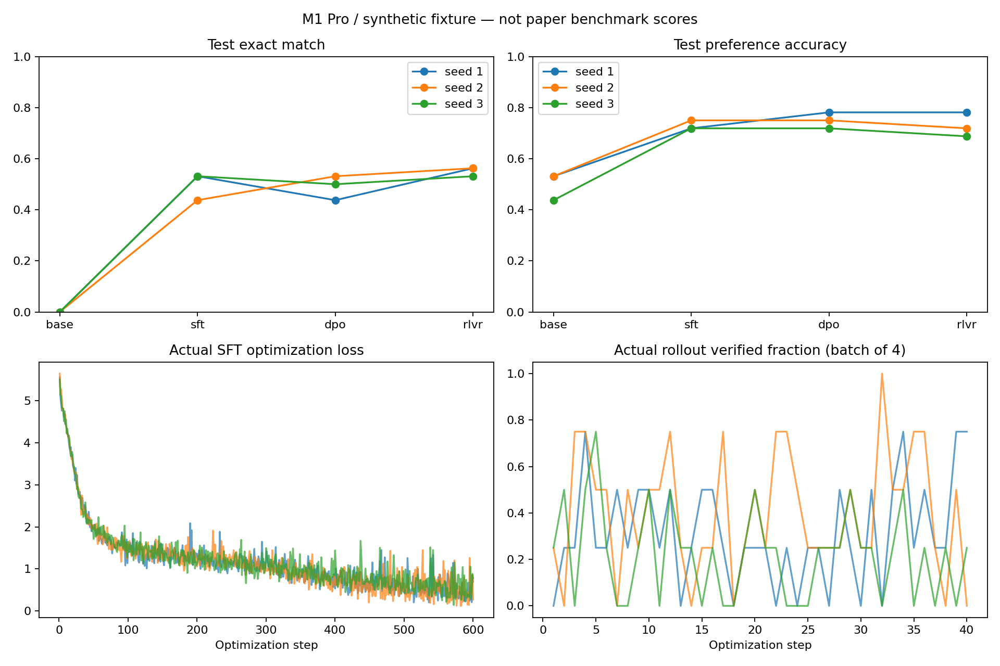

# Apple Silicon experiment report

These are actual local executions, not Tülu benchmark reproductions. The default experiment uses synthetic addition/copy tasks and a randomly initialized tiny GPT-2 architecture. The pretrained run uses the same fixture to test the Hugging Face model path.

## Measurement protocol

The split seed is fixed at 42: 200 SFT, 80 preference/RM, 56 RLVR, 32 validation and 32 test prompts. All five sets have disjoint normalized prompts. No hyperparameters or checkpoints are selected using test scores; the final step of every stage is evaluated. This is exact-prompt decontamination, not semantic or n-gram decontamination. Each exact-match test point is 1/32 (3.125 percentage points). The tasks do not measure general instruction following, safety or reasoning.

Experiments run sequentially to avoid competing device workloads. Runtime below includes all stage evaluations and checkpoint writes, but excludes model construction/download. Peak RSS is the process high-water mark, not total system or Metal memory. The host was not exclusively reserved, so timings are descriptive. CPU/MPS trajectories need not be bitwise identical.

| Run | Device | Parameters | Seconds | Peak process RSS GiB | SFT EM | DPO EM | RLVR EM |
|---|---|---:|---:|---:|---:|---:|---:|
| [ablation-dpo-sum](ablation-dpo-sum/summary.json) | mps | 124,864 | 44.8 | 0.58 | 50.00% | 56.25% | 53.12% |
| [ablation-no-dpo](ablation-no-dpo/summary.json) | mps | 124,864 | 42.1 | 0.51 | 53.12% | 53.12% | 59.38% |
| [ablation-no-kl](ablation-no-kl/summary.json) | mps | 124,864 | 47.1 | 0.52 | 53.12% | 56.25% | 53.12% |
| [ablation-random-value](ablation-random-value/summary.json) | mps | 124,864 | 45.0 | 0.59 | 56.25% | 50.00% | 56.25% |
| [full-cpu-seed1](full-cpu-seed1/summary.json) | cpu | 124,864 | 18.6 | 0.30 | 56.25% | 53.12% | 56.25% |
| [full-mps-seed1](full-mps-seed1/summary.json) | mps | 124,864 | 46.0 | 0.51 | 53.12% | 43.75% | 56.25% |
| [full-mps-seed2](full-mps-seed2/summary.json) | mps | 124,864 | 50.5 | 0.55 | 43.75% | 53.12% | 56.25% |
| [full-mps-seed3](full-mps-seed3/summary.json) | mps | 124,864 | 47.2 | 0.50 | 53.12% | 50.00% | 53.12% |
| [smollm2-mps](smollm2-mps/summary.json) | mps | 134,515,008 | 105.7 | 1.27 | 56.25% | 56.25% | 56.25% |

## Across-seed results

Arithmetic mean ± sample standard deviation across the three MPS seeds; these are descriptive statistics, not confidence intervals.

| Stage | Test exact match | Preference accuracy | Mean response NLL |
|---|---:|---:|---:|
| base | 0.0000 ± 0.0000 | 0.5000 ± 0.0541 | 5.5993 ± 0.0602 |
| sft | 0.5000 ± 0.0541 | 0.7292 ± 0.0180 | 0.9358 ± 0.1425 |
| dpo | 0.4896 ± 0.0477 | 0.7500 ± 0.0312 | 1.0359 ± 0.1163 |
| rlvr | 0.5521 ± 0.0180 | 0.7292 ± 0.0477 | 0.9928 ± 0.1434 |

The mean RLVR-minus-DPO exact-match change is +6.25 percentage points. A change on this small synthetic sample does not establish a general RLVR improvement. Preference likelihood and free-generation correctness measure different things; lower loss alone is not sufficient.

## Interpretation and limits

- The stage checkpoints, finite optimization traces and successful reload tests demonstrate executable training, rather than a simulated loss curve. The base model in the tiny runs has no pretraining knowledge.
- SFT receives correct targets, DPO compares chosen/rejected likelihoods against an immutable SFT cache, and PPO receives only sampled-response verifier rewards plus a reference-policy KL penalty. Missing EOS incurs a separate penalty, so a negative mean reward can coexist with some verified answers.
- Ablations remove DPO, remove KL, use summed DPO with beta=0.1, or initialize the critic from the policy with a fresh head instead of the trained RM. Each uses seed 1 only; the DPO-sum comparison changes beta too. They are diagnostic comparisons, not controlled estimates of independent causal effects. Even equal-seed MPS runs can have different SFT baselines due to numerical nondeterminism. Removing DPO also changes later RNG consumption, so generated trajectories are not paired.
- CPU/MPS timing uses one CPU run and one comparable MPS run on this machine. Very small models can favor CPU because accelerator dispatch costs dominate. Do not extrapolate to large models.
- No all-task OLMES suite, judge-model evaluation, published dataset mixtures, 8B/70B/405B scaling or paper-wide data ablations were run. [Coverage audit](../../docs/apple_silicon.md#paper-coverage) lists these gaps.

## Evidence and rerunning

Each run contains `config.json`, `dataset.json`, `metrics.jsonl`, `rollouts.jsonl`, `dpo_reference.json` (unless skipped), `evaluations.json` and `summary.json`. Summaries include package versions, source hashes, device, timing and revision. Checkpoints are present locally but git-ignored. `environment-lock.txt` records this Mac's installed packages; it is not a cross-platform lockfile.

```bash
.venv-mac/bin/python scripts/portable/experiments.py --include-pretrained --output output/mac-reproduction
.venv-mac/bin/python scripts/portable/report.py --input output/mac-reproduction --demo-dir output/mac-demo-media
```



The earlier `mps-seed1` directory is a 120-step SFT pilot retained for transparency; it is excluded from the comparison table and aggregate statistics. The main preset uses 600 SFT steps.
