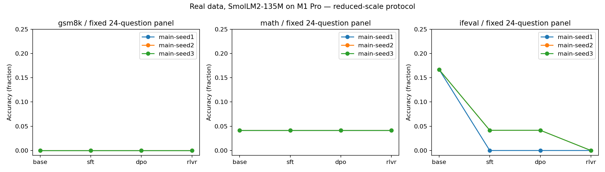
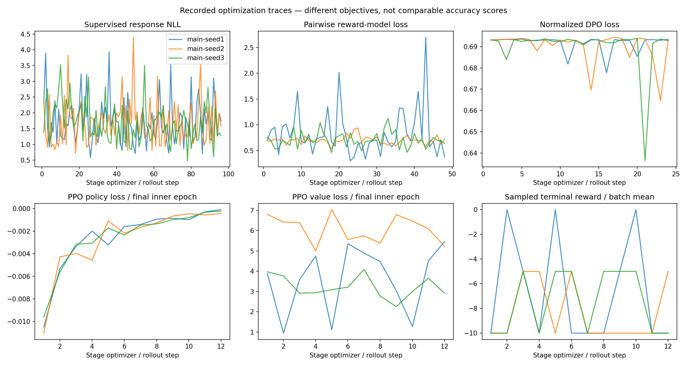

# Tülu 3 real-data experiments on M1 Pro

**Scope:** actual published training examples and real task questions, SmolLM2-135M, short local budgets. This is not a reproduction of Tülu 3 published scores or its original model scale.

Completed: 3/3 full training seeds, 10/10 anchored RL branches. Pending/incomplete training runs: none.

[Detailed protocol and deviations](../../docs/tulu3_mac_experiments.md) · [Frozen plan](plan.json) · [Data provenance](data-v2/manifest.json) · [Runtime](environment-lock.txt)

## Data coverage

Training: 96 SFT rows across 15 sources, 48 unchanged preference pairs across 7 sources, 72 RL prompts (24 per domain), 16 unused preference pairs, 24 validation and 72 test questions. Data come from pinned revisions of every SFT/preference shard. The scan and length-filtered source-balanced selection are bounded and differ from original mixture proportions. Exact normalized prompts and 13-word spans are screened against all 2,360 evaluation questions.

## Stage-by-stage results (72-question fixed panel)

| Run | Stage | GSM8K / 24 | MATH-500 / 24 | IFEval strict / 24 | IFEval loose | EOS rate |
|---|---|---:|---:|---:|---:|---:|
| [main-seed1](main-seed1/summary.json) | base | 0.00% | 4.17% | 16.67% | 16.67% | 0.00% |
| [main-seed1](main-seed1/summary.json) | sft | 0.00% | 4.17% | 0.00% | 0.00% | 0.00% |
| [main-seed1](main-seed1/summary.json) | dpo | 0.00% | 4.17% | 0.00% | 0.00% | 0.00% |
| [main-seed1](main-seed1/summary.json) | rlvr | 0.00% | 4.17% | 0.00% | 0.00% | 0.00% |
| [main-seed2](main-seed2/summary.json) | base | 0.00% | 4.17% | 16.67% | 16.67% | 0.00% |
| [main-seed2](main-seed2/summary.json) | sft | 0.00% | 4.17% | 4.17% | 4.17% | 1.39% |
| [main-seed2](main-seed2/summary.json) | dpo | 0.00% | 4.17% | 4.17% | 4.17% | 1.39% |
| [main-seed2](main-seed2/summary.json) | rlvr | 0.00% | 4.17% | 0.00% | 0.00% | 1.39% |
| [main-seed3](main-seed3/summary.json) | base | 0.00% | 4.17% | 16.67% | 16.67% | 0.00% |
| [main-seed3](main-seed3/summary.json) | sft | 0.00% | 4.17% | 4.17% | 4.17% | 0.00% |
| [main-seed3](main-seed3/summary.json) | dpo | 0.00% | 4.17% | 4.17% | 4.17% | 0.00% |
| [main-seed3](main-seed3/summary.json) | rlvr | 0.00% | 4.17% | 0.00% | 0.00% | 0.00% |

Test-panel resolution is 4.17 percentage points per domain. Final-step checkpoints are fixed in advance; no best-of-test checkpoint selection was performed. Raw predictions, including failures and incomplete answers, are saved.

## Across-seed variation

| Stage | GSM8K mean ± SD | MATH mean ± SD | IF strict mean ± SD |
|---|---:|---:|---:|
| base | 0.00% ± 0.00% | 4.17% ± 0.00% | 16.67% ± 0.00% |
| sft | 0.00% ± 0.00% | 4.17% ± 0.00% | 2.78% ± 2.41% |
| dpo | 0.00% ± 0.00% | 4.17% ± 0.00% | 2.78% ± 2.41% |
| rlvr | 0.00% ± 0.00% | 4.17% ± 0.00% | 0.00% ± 0.00% |

Observed across completed seeds: mean overall panel accuracy changed from 6.94% at the base checkpoint to 1.39% after RLVR (-5.56 percentage points). This measurement describes the fixed small panel and reduced training recipe; it is not a claim about the original Tülu 3 method.

## Checkpoint-anchored ablations

Compare against the **control fork**, not the main seed-1 trajectory: every fork restarts the same RL RNG and fresh optimizer. Anchor hashes are in each summary. The no-DPO and DPO-sum recipes intentionally use the SFT anchor; other variants must have exactly the control DPO anchor. Changing policy or prompt distribution changes future samples.

| Branch | GSM8K | MATH | IF strict | Paired wins/losses vs control | Exact McNemar p |
|---|---:|---:|---:|---:|---:|
| [control](control/summary.json) | 0.00% | 4.17% | 0.00% | 0/0 | 1.0000 |
| [kl-zero](kl-zero/summary.json) | 0.00% | 4.17% | 0.00% | 0/0 | 1.0000 |
| [kl-001](kl-001/summary.json) | 0.00% | 4.17% | 0.00% | 0/0 | 1.0000 |
| [kl-010](kl-010/summary.json) | 0.00% | 4.17% | 0.00% | 0/0 | 1.0000 |
| [no-dpo](no-dpo/summary.json) | 0.00% | 4.17% | 0.00% | 0/0 | 1.0000 |
| [dpo-sum](dpo-sum/summary.json) | 0.00% | 4.17% | 4.17% | 1/0 | 1.0000 |
| [policy-critic](policy-critic/summary.json) | 0.00% | 4.17% | 4.17% | 1/0 | 1.0000 |
| [gsm-only](gsm-only/summary.json) | 0.00% | 4.17% | 4.17% | 1/0 | 1.0000 |
| [math-only](math-only/summary.json) | 0.00% | 4.17% | 0.00% | 0/0 | 1.0000 |
| [if-only](if-only/summary.json) | 0.00% | 4.17% | 0.00% | 0/0 | 1.0000 |

These p-values are exploratory and uncorrected for multiple comparisons. Single-seed forks and tiny panels cannot establish a robust algorithm ranking. Summed DPO changes both beta and normalization.

## Full question coverage under a bounded decoding budget

| Result | Correct / total | Accuracy (Wilson 95% interval) | EOS rate | Symbolic timeouts / length skips |
|---|---:|---:|---:|---:|
| [benchmark-rlvr-128/gsm8k-summary.json](benchmark-rlvr-128/gsm8k-summary.json) | 23/1319 | 1.74% (1.16%–2.60%) | 0.08% | 0 / 0 |
| [benchmark-rlvr-128/ifeval-summary.json](benchmark-rlvr-128/ifeval-summary.json) | 79/541 | 14.60% (11.88%–17.83%) | 0.18% | 0 / 0 |
| [benchmark-rlvr-128/math-summary.json](benchmark-rlvr-128/math-summary.json) | 7/500 | 1.40% (0.68%–2.86%) | 1.20% | 1 / 17 |

Additional paper-relevant aggregation: MATH-500 subject macro accuracy **0.98%**; IFEval loose prompt accuracy **17.01%**. [Subject, difficulty and instruction breakdowns](BENCHMARK_ANALYSIS.md) preserve both strict and loose results. The main benchmark table above uses question-level micro accuracy (strict for IFEval).

These intervals reflect question-level binomial sampling uncertainty, not training-seed uncertainty. For IFEval the table uses prompt-level strict accuracy; the result JSON also includes loose and instruction-level scores. Symbolic timeout/length-skip counts are candidate-comparison events, potentially multiple per response. Only the preselected final seed-1 checkpoint is evaluated on every question; these totals do not estimate full-bank improvement over the base model. **128 generated tokens and zero-shot prompts do not reproduce the paper protocol.** Long instruction requests may be impossible under this cap, and mathematical solutions may stop before reaching an answer. MATH-500 is not the full MATH test set.

## Untouched preference holdout

The 16 original held-out chosen/rejected pairs are scored by length-normalized response log probability. This is pairwise label agreement, not a judge-based chat win rate. Ties count as incorrect.

| Run | Base | SFT | DPO | RLVR |
|---|---:|---:|---:|---:|
| main-seed1 | 62.50% | 56.25% | 56.25% | 56.25% |
| main-seed2 | 62.50% | 56.25% | 56.25% | 56.25% |
| main-seed3 | 62.50% | 56.25% | 56.25% | 56.25% |

## Observed RL training signal

| Run | Verified rollouts | EOS rollouts | Positive terminal rewards | Mean terminal reward |
|---|---:|---:|---:|---:|
| main-seed1 | 2/24 | 8/24 | 0/24 | -6.667 |
| main-seed2 | 2/24 | 4/24 | 0/24 | -8.333 |
| main-seed3 | 2/24 | 6/24 | 0/24 | -7.500 |
| control | 3/24 | 1/24 | 0/24 | -9.583 |
| kl-zero | 3/24 | 1/24 | 0/24 | -9.583 |
| kl-001 | 3/24 | 1/24 | 0/24 | -9.583 |
| kl-010 | 3/24 | 1/24 | 0/24 | -9.583 |
| no-dpo | 3/24 | 1/24 | 0/24 | -9.583 |
| dpo-sum | 3/24 | 1/24 | 0/24 | -9.583 |
| policy-critic | 3/24 | 1/24 | 0/24 | -9.583 |
| gsm-only | 0/24 | 6/24 | 0/24 | -7.500 |
| math-only | 0/24 | 2/24 | 0/24 | -9.167 |
| if-only | 4/24 | 3/24 | 1/24 | -8.333 |

Correctness is measured independently of EOS. Without EOS, the terminal reward is -10 even when a verifier passes, as specified by this fixed configuration. A run dominated by this penalty does not test the benefits of sustained positive verifier rewards.

## Decoding-budget sensitivity

A supplementary paired check generates up to 512 tokens for the same 72 test prompts at the base and final seed-1 checkpoints. It is not used for checkpoint or hyperparameter selection. More tokens can both recover answers and introduce new instruction violations.

| Checkpoint | Task | Correct at 128 / 24 | Correct at 512 / 24 | Gained / lost | EOS at 512 |
|---|---|---:|---:|---:|---:|
| base | gsm8k | 0 | 0 | 0 / 0 | 0.00% |
| base | math | 1 | 1 | 0 / 0 | 0.00% |
| base | ifeval | 4 | 5 | 2 / 1 | 0.00% |
| rlvr | gsm8k | 0 | 0 | 0 / 0 | 0.00% |
| rlvr | math | 1 | 1 | 0 / 0 | 0.00% |
| rlvr | ifeval | 0 | 2 | 2 / 0 | 0.00% |

## Failure and limitation analysis

- The panel extraction check flags 3/3 final-checkpoint MATH passes with a last-LaTeX expression copied from the question ([saved cases](verifier-audit-panel.json)). Repeating an equivalent expression can receive verifier credit without solving the task. The full-benchmark subgroup analysis flags analogous last-LaTeX copies without silently changing the scoring rules.
- One-question gains on the small panel do not establish a robust improvement. Inspect responses for instruction echoes that can satisfy mechanical constraints without completing the requested task.
- The original 2.8 MPS real-data pilot failed during SFT on nonfinite gradient norm. Its console and independent 96-step diagnostic are retained. The independent diagnostic did not reproduce that failure; the precise cause is unproven. The main matrix uses separately pinned PyTorch 2.15 and is checked for finite losses/gradients.
- An eager-attention attempt reached about 12 GB physical footprint with heavy swapping and was stopped after RM. Its diagnostics and checkpoints remain separate. The completed matrix uses SDPA, final-position generation logits, cache release, activation checkpointing and an explicit MPS allocation limit; archived sources identify each attempt. The first capped SDPA attempt also stopped on RM allocation pressure; longest-example RM/DPO/PPO stress tests preceded the final matrix.
- Low math scores or unchanged scores are expected possible outcomes for a 135M base model and short training budget. Successful execution is not evidence of useful reasoning capability or replication of paper gains.
- A small EOS rate means missing-EOS penalties can dominate PPO. Inspect raw verifier successes separately from mean rewards. Rewards are not silently changed to make the curves look better.
- Real labels replace synthetic wrong answers for DPO. The RL training IF checker follows the released legacy constraints, while the official benchmark uses the current repository instruction registry. Verifier and protocol differences remain explicit.
- Published model scale, complete mixture training, all data ablations, judge/human evaluations and the full OLMES capability/safety/unseen suite remain unexecuted. No incomplete job is included in completed counts.

## Reproduce and inspect

```bash
.venv-mac-real/bin/python -m scripts.portable.real_experiments suite
.venv-mac-real/bin/python -m scripts.portable.report_real
```

Check `data-v2/selected_original_rows.json`, per-run `metrics.jsonl` and `rollouts.jsonl`, checkpoint hashes, saved predictions, and complete benchmark summaries. Checkpoints remain local and git-ignored.




